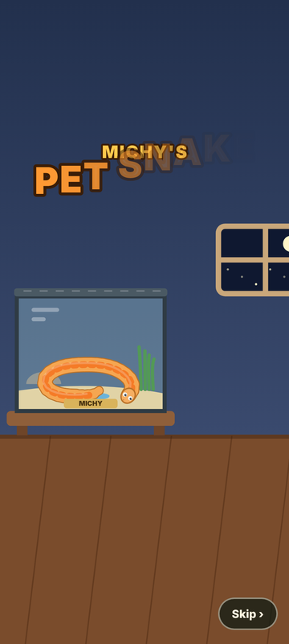
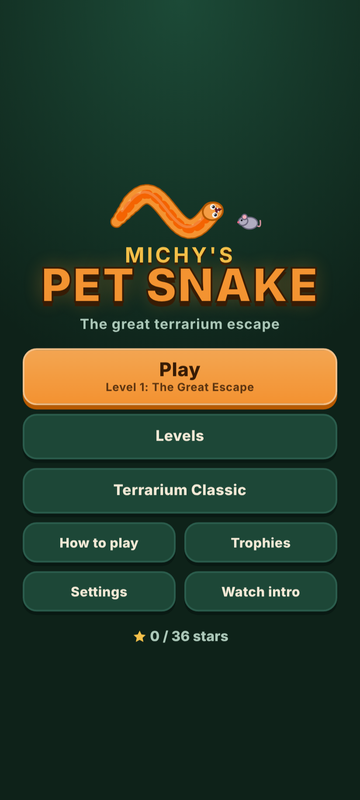
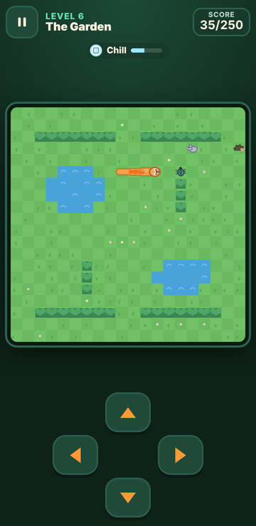
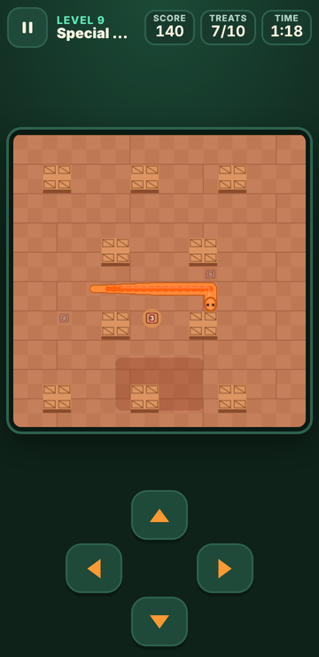

# 🐍 Michy's Pet Snake

**Michy left the terrarium lid open.** Help her pet snake escape, explore the house and
hunt its way from the bedroom to the wild, across a 12-level arcade Snake adventure.

<p>
  
  
  
  
</p>

Classic Snake controls with a story, characters, power-ups and a proper campaign. It runs
**offline** in any modern browser and as an **Android app** (WebView). There are no
accounts, ads or tracking, and the whole game is about 170 KB.

## Features

- 🎬 A 4.5-second **opening cutscene**: the great terrarium escape (skippable, replayable)
- 🗺️ **12 levels** in 10 rooms (bedroom, living room, hallway, garden, kitchen, basement,
  porch, a dark living room, attic and the wild). Each one adds something new
- 🐭 Prey with personalities: mice (some run away!), beetles, hopping crickets, rare golden moths
- 🛡️ Power-ups: **Shell Shield**, **Zoomies**, **Chill Cube**
- 🦔 Hazards that patrol: a hedgehog and robot vacuums
- ⭐ Stars for fast clears, best scores, 13 trophies and 4 unlockable snake colours
- 🫙 **Terrarium Classic**: the original Aspect Snake rules as an endless mode (your old high score carries over)
- 👆 Swipe, on-screen pad or keyboard. Pauses itself when you leave the app

## Play it now (browser)

Open `web/index.html` in Chrome, Edge, Firefox or Safari. That's all, no install needed.
Or run a local server:

```bash
npm run serve        # then open http://127.0.0.1:8080
```

**Controls:** swipe on the board / tap the arrow pad / arrow keys or WASD.
Pause with the ⏸ button, Space, P or Esc.

## Build the Android app

**Just want the APK?** GitHub builds it automatically: **Actions → Android APK → newest run →
Artifacts → michys-pet-snake-debug-apk**. Unzip it and install `app-debug.apk` on your phone.

To build it yourself, open the **`android/`** folder in Android Studio and press **Run**.
Full step-by-step guide, release signing and troubleshooting: **[docs/BUILD_APK.md](docs/BUILD_APK.md)**.

> The APK builds on GitHub, but it hasn't been tested on a real phone yet (see the [test report](docs/TESTING.md#not-verified)).

## Project layout

```
web/        the game (HTML, CSS, JS). This folder is also the Android app's content
android/    Android Studio project: a full-screen WebView around web/
tests/      unit tests, an autopilot that proves every level can be won, browser tests
docs/       design notes, APK guide, test report, screenshots
original/   the original Aspect Snake, untouched
```

## Tests

```bash
npm test                                         # 45 unit tests, no install needed
npm install && npx playwright install chromium   # once
npm run test:e2e                                 # 86 browser checks at 4 screen sizes
```

The unit tests also run automatically on GitHub on every push (see the Actions tab).

## Publish the browser version (optional)

1. On GitHub: **Settings → Pages → Build and deployment → Source: GitHub Actions**.
2. **Actions → Publish to GitHub Pages → Run workflow**.
3. The game will be at `https://tshumasicelo.github.io/Michy-Pet-Snake/`.

## More

- [Design and architecture](docs/DESIGN.md): original audit, research, level-by-level design
- [Test report](docs/TESTING.md): what was tested, what wasn't
- [Changelog](CHANGELOG.md)
